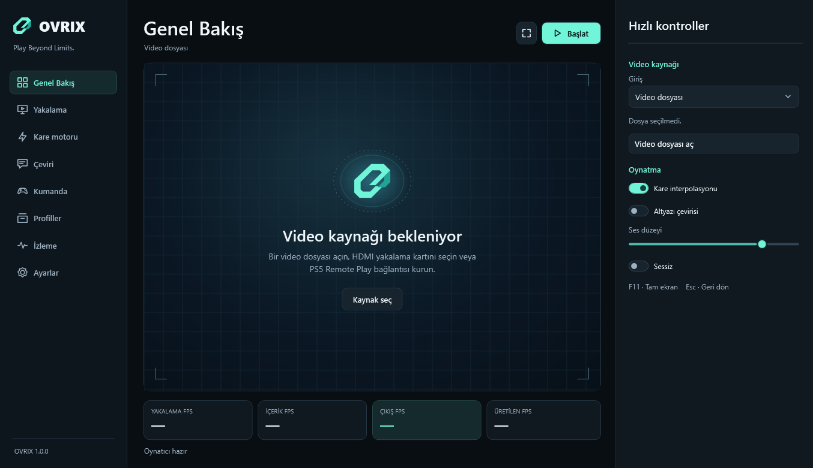
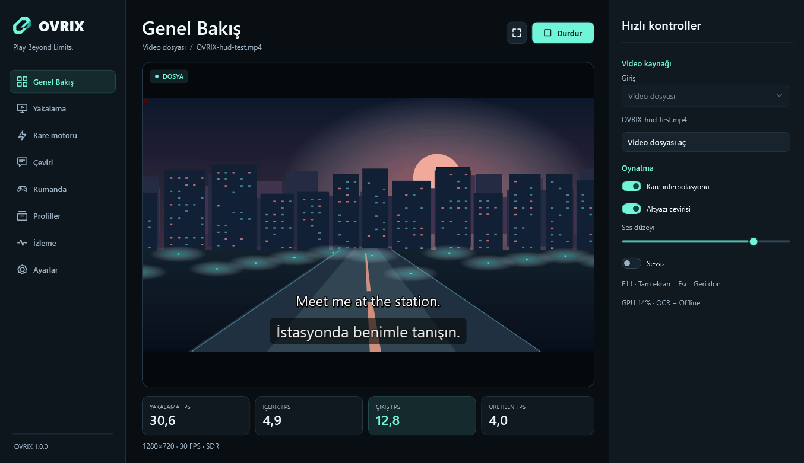

# OVRIX

**Play Beyond Limits.** OVRIX, Windows üzerinde oyun görüntüsüne GPU kare interpolasyonu uygulayan ve ekrandaki altyazıyı OCR ile okuyup Türkçe olarak görüntüleyen açık kaynaklı bir masaüstü uygulamasıdır. GTA VI hedefiyle başlayan proje, desteklenen video kaynakları üzerinden başka oyunlarda da kullanılabilir.

## Video demosu

HDMI kartı olmadan **Yakalama → Video dosyası** yoluyla oynatılabilecek [29 saniyelik test klibi](docs/media/ovrix-demo.mp4). Görüntü sentetik olarak oluşturuldu. İngilizce satır kaynak videoda, alttaki Türkçe satır OVRIX'in canlı HUD'ında yer alır.

İki dosya testinde, model açıkken yeni altyazıların medyan ekrana ulaşma süresi **259 ms** ve **397 ms** oldu. İlk satır model açılışıyla birlikte **1,80–1,95 saniye** sürdü. Çevrimdışı model bağlam ve deyimlerde hatalar yaptı. Cihaz doğrulaması ve 1.0.0 yayın kapsamı [test ve kabul raporunda](docs/TESTING.md) yer alıyor.

## Başlangıç

1. [Derleme ve paketleme adımlarıyla](docs/BUILD.md) Windows x64 paketi oluşturun. Kurulumu çalıştırın veya portable ZIP'i açıp `OVRIX.exe` dosyasını başlatın.
2. Kullanacağınız FFmpeg Windows dağıtımında `ffmpeg.exe` ile `ffprobe.exe` aynı dizinde bulunmalıdır. PATH'e ekleyin veya **Ayarlar → FFmpeg** bölümünden yürütülebilir dosyayı seçin.
3. **Yakalama** bölümünden giriş seçin. İlk deneme için ses içeren bir MP4 seçip **Başlat** düğmesine basın. **F11** tam ekran, **Esc** normal görünüm.
4. Altyazı için Windows OCR'de oyunun dilini ekleyin. **Çeviri** bölümünden sağlayıcıyı, kaynak dili ve hedef dili seçin. Varsayılan EN → TR'dir. Ayrı Python ortamı ve Nixani kurulumu [BUILD.md](docs/BUILD.md) dosyasındadır.

HDMI için video ve ses aygıtını seçin. Remote Play için Nixani Engine 1.1.0, kendi PS5'inizde etkin Remote Play ve yetkili hesap gerekir. Ayrıntılar [BUILD.md](docs/BUILD.md) dosyasındadır.

Yakalama FPS, özgün içerik tahmini, oynatıcıya iletilen çıkış ve ara kare hızları ayrı ölçülür. Görüntü işlemesi konsolun çalışma hızını değiştirmez.

OVRIX bağımsız bir projedir. Rockstar Games, Take-Two Interactive ve Sony Interactive Entertainment ile resmî bağlantısı yoktur.

## Geliştirme

- [Derleme ve kurulum](docs/BUILD.md)
- [Mimari](docs/ARCHITECTURE.md)
- [Uygulama planı](docs/IMPLEMENTATION_PLAN.md)
- [Doğrulama](docs/TESTING.md)
- [Lisans denetimi](docs/LICENSE_AUDIT.md)
- [Üçüncü taraf bildirimleri](THIRD_PARTY_NOTICES.md)
- [Güvenlik](SECURITY.md)
- [Katkı](CONTRIBUTING.md)
- [Değişiklikler](CHANGELOG.md)
