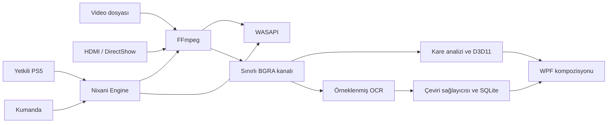

# Mimari

- `apps/desktop` iki dilli WPF kabuğu ve son altyazı katmanıdır. UI iş parçacığı yalnız mevcut en yeni kareyi görüntüler ve altyazı bileşimini çizer.
- `src/capture` FFmpeg/FFprobe süreçlerini yönetir. DirectShow cihaz biçimlerinden seçim yapılır. BGRA taşımada özgün PTS alınır. PCM ayrı yerel borudadır. Tanınan HDR dosya girişleri doğrusal renge, ardından BT.709 SDR'ye dönüştürülür.
- `src/frame-engine` örneklemeli değişim analizi, iki yönlü D3D11 hareket kestirimi, güvene dayalı warping ve keskinleştirme içerir. Yazılım yolu bilineer ölçekleme ve global hareket kestirimi kullanır. Görüntü en boy oranını korur. GPU çıktısı WPF için CPU belleğine okunur.
- `src/remote-play` Nixani v2 mesajlarını özel süreç borularından okur. H.264 Annex B ortak görüntü yoluna, işlenmiş PCM WASAPI'ye iletilir. DPAPI konsol kayıtlarını ve belirteçleri Windows kullanıcısına bağlar.
- `src/translation` özgün kareyi örnekler. OCR dikdörtgenleri, normalizasyon ve iki örneklik stabilizasyon uygular. OCR'nin güven değeri yayımlanmadığı için kontrast varyantı için metin puanı kullanılır. Yeni satır eskisini iptal eder. Sürüm kontrolü geç gelen sonucun görüntüye yazılmasını engeller.
- `src/core` oturum, ölçüm ve kalıcı JSON ayarlarını içerir. GPU motoru yoksa yazılım yoluna düşer. Kaynak, görüntüleme ve işlem kayıpları görünür.

Sınırlamalar Windows 11 HDR sunum zinciri, VRR swap chain, GPU üzerinde sıfır kopya görüntü sunumu, donanım çapında kalibre edilmiş ses/video sapması, AI video yükseltme ve bütünleşik PSN tarayıcı oturum açma kapsamındadır. Belgelenen tanılama gecikmesi kod çözümü sonrası yazılım hattını ölçer. Çıkış FPS'i WPF'ye iletilen kare sayısıdır. Tarama ekranı fiziksel panel yenileme hızını ölçmez.
